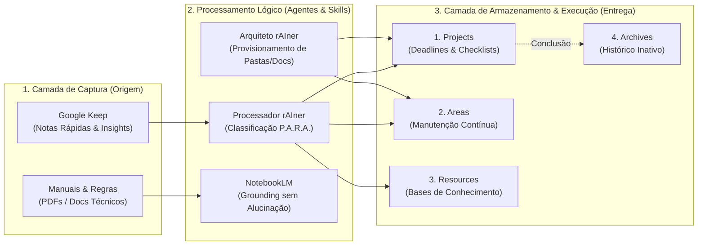

# rAIner: Sistema Cognitivo de Produtividade Orquestrado por IA

> Arquitetura de Segundo Cérebro baseada no método P.A.R.A., integrando o ecossistema Google Workspace e agentes de Inteligência Artificial para eliminar sobrecarga mental operacional.

---

## 📌 O Desafio de Negócio

Profissionais em cargos de liderança técnica, operações e tecnologia frequentemente lidam com múltiplos contextos simultâneos:
- **Operação técnica/corporativa:** Sustentação de ERPs, regras fiscais, modelagem de dados e validações críticas.
- **Vida pessoal e patrimonial:** Manutenções preventivas, finanças familiares, eventos de vida de alto impacto.
- **Sobrecarga de ferramentas ("Tool Fatigue"):** Adoção de ferramentas complexas (como Notion ou Obsidian) que demandam manutenção manual contínua, gerando atrito de entrada e abandono do fluxo.

O problema central não é a falta de ferramentas, mas a **ausência de um pipeline de triagem automatizado** capaz de capturar dados brutos rapidamente e classificá-los sem intervenção manual exaustiva.

---

## 🎯 O Objetivo

* **Captura Ubíqua com Zero Atrito:** Centralizar anotações rápidas em uma caixa de entrada nativa mobile (Google Keep).
* **Triagem e Processamento por Agentes:** Delegar a categorização, síntese e alocação de itens para agentes de IA estruturados (Skills).
* **Estrutura P.A.R.A. Padronizada:** Manter projetos, áreas de responsabilidade, recursos e arquivos no Google Drive com Documentos Mestres padronizados.
* **Consulta Sem Alucinação:** Isolar bases de conhecimento técnicas e regras corporativas fechadas via NotebookLM com ancoragem estrita nas fontes.
* **Preservação do Human-in-the-Loop:** Garantir que execuções críticas e conclusões de tarefas permaneçam sob validação e controle do usuário.

---

## 📐 Arquitetura do Fluxo de Dados

---

## 🛠️ A Solução Técnica

O ecossistema foi estruturado sobre quatro pilares funcionais:

1. Separação Rígida entre Armazenamento e Orquestração:

* O Google Drive atua como storage hierárquico imutável.

* Os agentes de IA funcionam como middleware de leitura, formatação e despacho.

2. Skills Customizadas e Determinísticas:

* arquiteto-rainer: Automatiza o provisionamento de pastas e gera o Documento Mestre com seções de Metas, Checklists e Notas, aplicando taxonomia estrita para diferenciar Projetos (com prazo) de Áreas (padrões de longo prazo).

* processador-keep-rainer: Recebe anotações em linguagem natural não estruturada e gera comandos de distribuição contextual para os documentos de destino.

3. Arquitetura Anti-Alucinação (Grounded Retrieval):

* Utilização do NotebookLM para regras de negócio proprietárias e documentações técnicas complexas, restringindo respostas exclusivamente às fontes indexadas.

* Ciclo de Revisão Semanal (Weekly Review):

* Rito periódico semanal para execução de checklists, arquivamento de iniciativas concluídas e limpeza da caixa de entrada.

---
## 🚀 Impacto Esperado (ou Real)

* Redução Drástica de Carga Cognitiva: Eliminação da necessidade de memorizar pendências periféricas durante a rotina técnica.

* Aderência Sustentável: Tempo médio semanal de manutenção do sistema inferior a 20 minutos, evitando o abandono comum em plataformas de alta fricção.

* Custo Zero de Licenciamento: Utilização integral de aplicações nativas acessíveis em qualquer dispositivo sem dependência de ferramentas pagas de nicho.

* Segurança e Isolamento de Dados: Manutenção das informações dentro do próprio ambiente pessoal/corporativo do Google Workspace.  
